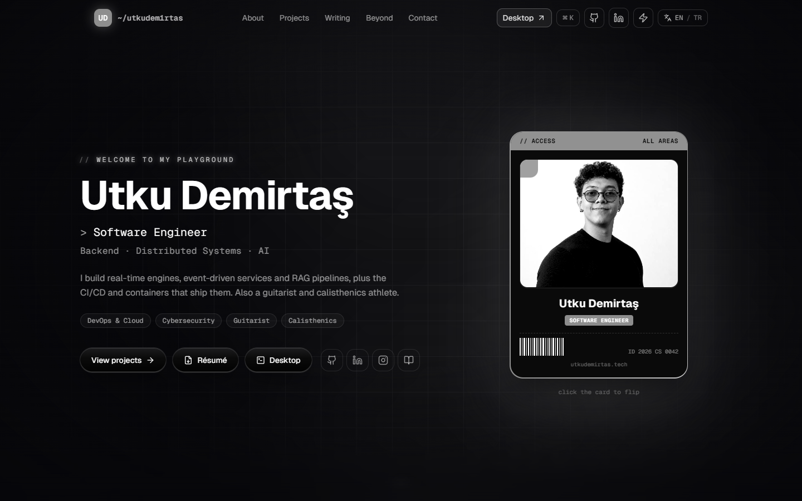

# 🚀 Utku Demirtaş · Software Engineer
Source of my personal portfolio: a Next.js site with WebGL effects, plus **utkuOS**, a tiny Linux desktop that runs in the browser.

> **Backend · Distributed Systems · AI.** Computer engineering graduate with hands-on backend and DevOps experience.

- 🌐 **Live:** [www.utkudemirtas.tech](https://www.utkudemirtas.tech)
- 🖥️ **utkuOS:** [www.utkudemirtas.tech/desktop](https://www.utkudemirtas.tech/desktop)
- 💻 **GitHub:** [github.com/Urthella](https://github.com/Urthella)



## 🌟 Features
- **Five pages, one shell:** Home, About, Projects, Writing and Beyond share a route-group layout, so the fluid background, nav and footer never remount between pages. Projects adds category filters and a live GitHub contribution heatmap.
- **utkuOS desktop (`/desktop`):** a GNOME-flavoured desktop with a boot log, draggable and snappable windows, a dock, an activities overview, a phone layout and lazily loaded apps (Terminal, Files, Résumé, Mail, System Monitor, Settings and more). The terminal parses like bash and Tab-completes over a virtual filesystem built from the site content; type `help` to start, and there are a few hidden things to find.
- **WebGL that earns its keep:** a fluid simulation follows the cursor, and the contact button is a signed-distance-field shader "venom" that bursts the contact form out of its pill. The form sends through EmailJS straight from the browser, so there is no backend.
- **Performance guard:** heavy visuals switch to lite mode based on, in order: the user's toggle, `prefers-reduced-motion`, then a one-time FPS measurement cached in `localStorage`. Touch devices skip the fluid sim entirely.
- **Bilingual and keyboard-friendly:** English and Turkish from one content model, plus a `Ctrl/⌘ + K` command palette for pages, language, lite mode and the desktop.
- **Themeable and SEO-ready:** a custom accent color is applied before first paint (no orange flash), and every page gets its own metadata, a generated Open Graph image, a sitemap and JSON-LD.

## 🛠️ Tech Stack
- **Framework**: [Next.js 15](https://nextjs.org/) (App Router) with [React 19](https://react.dev/) and TypeScript
- **Styling**: [Tailwind CSS v4](https://tailwindcss.com/) with the typography plugin and [tw-animate-css](https://github.com/Wombosvideo/tw-animate-css)
- **Motion**: [Framer Motion](https://motion.dev/) for UI transitions, [GSAP](https://gsap.com/) for the card swap and projects cursor, hand-written WebGL shaders for the fluid and goo
- **UI**: [cmdk](https://cmdk.paco.me/) command palette, [Lucide](https://lucide.dev/) and [React Icons](https://react-icons.github.io/react-icons/), [Geist](https://vercel.com/font) font
- **Contact**: [EmailJS](https://www.emailjs.com/) browser SDK
- **Data**: GitHub contributions from the public [github-contributions-api](https://github-contributions-api.jogruber.de/)

## 🚦 Getting Started
**Requirements:** Node.js 18.18+ and npm.

```bash
git clone https://github.com/Urthella/portfolio-website.git
cd portfolio-website
npm install     # .npmrc sets legacy-peer-deps, so this resolves cleanly
npm run dev     # http://localhost:3000
```

Production build and lint:

```bash
npm run build && npm start
npm run lint
```

## 📧 Configuration
No environment variables are needed.
`.env.example` is stale: no code reads its `NEXT_PUBLIC_EMAILJS_*` variables, so you can skip it.

## 📂 Project Structure
- `app/(site)/`: the five site pages, wrapped in one shared layout
- `app/desktop/`: the utkuOS route
- `app/`: root layout, global CSS, Open Graph image, sitemap and robots
- `components/v2/`: site sections (hero, nav, projects, command palette, contact footer, ...)
- `components/desktop/`: utkuOS shell, window manager and virtual filesystem; `apps/` holds one file per app
- `components/venom-button/`: the WebGL venom contact button
- `components/ui/`: visual primitives (fluid cursor, 3D card, card swap, gradual blur, target cursor)
- `data/`: `content.ts` is the single source of truth for site copy; the Turkish version and the i18n provider live next to it
- `hooks/`: `use-perf`, the lite-mode detector
- `lib/`: accent color, per-page metadata, shared motion variants, `cn()`
- `public/`: profile photo, CV PDF, project images and cursor art
- `resume/cv.html`: the HTML source the CV PDF is printed from
